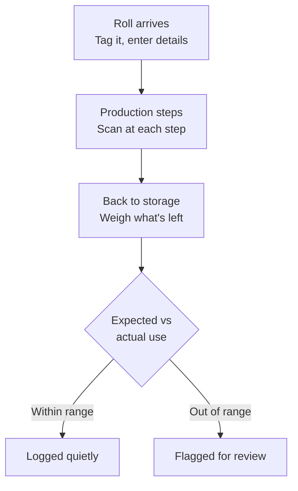

Imagine that you're the owner of a factory that manufactures clothing. Fabric is your main material. Every meter of fabric you lose eats into your competitive advantage.

Traditional workshops still use handwritten labels on their fabric rolls, and every change to the material is updated by hand. It's easy to see how the data drifts away from reality. The task is repetitive, and it takes time away from the real work.

Some fabric loss is expected. A study of a jeans manufacturer found that garment factories normally plan for [3 to 5 percent loss from cutting and shrinkage alone](https://doi.org/10.35530/IT.073.05.202188). The same study measured losses above that normal level over 40 days of production, and fabric was the biggest contributor.

Much of the loss above that normal level goes unnoticed because tracking it takes so much manual work. You can't expect workers to practice their craft and keep perfect records of every meter. Giving them simple systems instead will lower this loss.

## What this costs you

Percentages are easy to ignore, so let's put a number on it. Say your workshop buys $500,000 worth of fabric a year. Cutting and shrinkage will always take a few percent, and that part is normal. But if another 2% goes missing on top of that, through rolls that are miscounted, forgotten, or used without being recorded, that's $10,000 a year disappearing without anyone noticing. If tracking cuts that hidden loss in half, you keep $5,000 every year, and the savings repeat as long as the system runs.

## How I'd solve it

The first thing I'd do is find out what is still recorded on paper. Paper records drift from reality, and nobody notices until the stock doesn't add up. Moving those records into a digital system is the first step.

Before changing anything, I'd also measure where you stand today. For a few weeks, we compare how much fabric comes in with how much ends up in finished garments and known scrap. The gap is your real loss. That number matters for two reasons: it shows us where the fabric is going, and it's how we'll know the system works. You don't pay up front. Together we agree on a target against that starting point, such as cutting the hidden loss in half, and you pay a fixed fee only once the system reaches it. If it doesn't, you owe nothing.

To make the process digital, we attach an RFID label to each fabric roll as it arrives at the workshop. These labels cost a few cents each, which is tiny next to the value of a single roll. Unlike a printed barcode, an RFID label can be read without lining up a scanner, even through plastic wrap or with several rolls at once. Then we enter the roll's details into the system: fabric type, supplier, length, weight and color. It takes some time, but it only happens once per roll.

From then on, every scan of the label brings up that roll in the system. This makes it possible to update the material's data throughout the process with quick scans. Workers no longer need to rewrite a paper label or walk to the office computer to update a spreadsheet. They scan the label, and if a step needs extra details, they can type them in right there. If a step always uses the same amount of material, it gets even easier. The worker scans the label, and the system already knows how much that step should use. When the roll goes back to storage, we weigh it or measure what's left. The system compares what should have been used with what was actually used, and if the difference is too big, it flags it. That's where hidden loss finally becomes visible.

This isn't a new idea. Large fabric producers have tracked rolls with RFID for years. Griva, an Italian fabric maker, [reported a 30 percent return on its investment](https://www.textileworld.com/textile-world/textile-news/2007/08/griva-implements-alien-rfid-fabric-tracking-system) from better roll traceability and time savings. What's new is that the tags, readers and software are now cheap enough for a small workshop.

## What could go wrong

A system like this has to hold up on a busy day, so here's where I'd expect it to break.

**A roll gets cut into pieces.** Only one piece keeps the original label. Any leftover that goes back to storage gets a new label linked to the original roll, so every meter stays traceable and the weight check still adds up.

**The flag fires too often.** If every small difference triggers a warning, people stop looking. The first weeks of measuring show how much each step normally varies, and the threshold sits just above that. It tightens as data builds up.

**A scan fails or the system is down.** Production can't wait on a reader. Each label also carries a printed code that a phone can scan or a worker can type in, and the app keeps working offline and syncs later.

**Workers skip the scan.** If scanning feels like extra work, it won't happen, so each scan takes a second and asks for nothing unless a step needs it. And since every roll is weighed on return, a skipped scan still shows up as a gap.

**Rolling it out.** Tagging all existing stock at once would stop production. New rolls get tagged as they arrive, and old stock is tagged in small batches during quiet hours.

## Where to start

If you run a workshop and you're not sure how much fabric you lose, that's normal. Most owners don't know until they measure. Get in touch, and we'll start by measuring. If we find savings, I'm paid from them. If we don't, you've lost nothing and you'll know your numbers.
